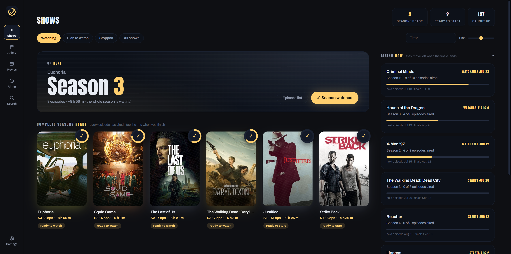

<div align="center">


# ShowTrack

**Wait for the finale. Then binge.**

A local-first TV and movie tracker for people who watch a season at a time.




</div>

---

ShowTrack is built around one idea: you watch a show once its whole season has finished
airing. So the dashboard waits for the finale, then surfaces the season as ready to binge.
One tap marks it done, and the Airing page lists every season still on air by the date it
becomes bingeable, rather than tracking single episodes.

> Complete seasons ready · every episode has aired · tap the ring when you finish

It runs on your Windows desktop and Android phone from one codebase and keeps everything in a
local database. It only goes online to fetch show data and posters from
[TheMovieDB](https://www.themoviedb.org) and, on the desktop, to check GitHub for a new
release. Your watch history never leaves your devices.

<sub>Watch episode by episode instead? One setting (Episode-by-episode) flips the season grid
to surface anything with a new episode, no waiting for the finale.</sub>

## What it does

**Watching**
- A season-first dashboard with an "Up next" pick, complete seasons ready to binge, and one-tap season marks with undo
- Watching, Plan to watch and Stopped lists; marking an episode of a planned show moves it to Watching
- A dedicated Anime tab: Japanese animation is detected from TMDB; turn on Ask where to add to file
  anything else there from Search
- An Airing page that groups shows by the month their current season becomes bingeable

**Your library**
- Movies with watch dates, rewatch counts, favorites and a watchlist
- Search TMDB to add anything; metadata is stored locally and posters are cached as you view them
- Import from a TV Time export, re-runnable at any time (desktop)
- Back up the whole library to one JSON file (desktop). Restoring merges: it adds what is
  missing and never deletes anything or overwrites your states. The file includes your TMDB
  key, so keep it private

**Across your devices**
- Two-way sync between desktop and phone over your home network, no cloud (see [below](#sync-your-phone))
- Turn off the Movies, Anime, Airing and Search pages, the Up next banner and the Airing now rail
- Custom window title (desktop), tile sizes, navigation order and more, all optional

## Get it

1. **Download** the latest [release](https://github.com/Nokama0/ShowTrack/releases/latest).
   - **Windows:** `ShowTrack_<version>_x64-setup.exe` installs it (recommended) and fetches
     Microsoft Edge WebView2 if it is missing.
   - **Windows, no install:** `ShowTrack_<version>_x64-portable.exe` is a single file. It needs
     WebView2, which ships with Windows 11 and current Windows 10.
   - The first launch may show a Windows SmartScreen warning because the app is not
     code-signed. Choose **More info**, then **Run anyway**.
   - **Android:** open `ShowTrack_<version>_arm64.apk` on the phone and allow installs from
     that app when Android asks. The APK is for 64-bit ARM (arm64) phones.
2. **Add a TMDB key.** ShowTrack asks for a free
   [TMDB API key](https://www.themoviedb.org/settings/api) (v3 key or v4 Read Access Token)
   on first run and validates it. All metadata and posters come from TMDB.
3. **Bring your history (optional).** Coming from TV Time? On the desktop, open
   Settings > Library data > Import from TV Time and pick your `.html` export from
   TV Time Out. Re-running it only adds and updates.

**Updates.** The desktop app checks GitHub for a new release on launch, or on demand from
Settings > Maintenance > **Check for updates**. Installed copies update through the installer;
portable copies replace themselves in place. On Android, install the new APK from the
releases page.

## Sync your phone

Two-way sync over your local network. No account and no cloud: the phone talks straight to
your PC over plain HTTP, so use it on a network you trust.

1. **On the desktop:** Settings > Library data > Phone sync, **Turn sync on**, then
   **Show pairing code**. The sync server runs only while the desktop app is open. If its
   port is taken, the panel says so; pick another and press **Apply port**.
2. **On the phone:** add a TMDB key when it asks on first run (the app opens nothing else
   until it has one), then go to Settings > Library data > Sync with desktop. Enter this
   PC's address with the port (find the IP with `ipconfig`, for example
   `192.168.1.20:47810`) and the 6-digit code, then **Pair & copy library**. The code is
   single use, valid for 5 minutes, and cancelled after 5 wrong tries.
3. Pairing merges the desktop library into the phone. Anything already on the phone is kept
   and sent to the desktop on the first sync. After that the phone syncs on its own at launch
   and whenever you return to the app (at most once a minute), or on demand with **Sync now**.

One phone at a time: pairing another phone replaces the first. **Unpair** only forgets the
pairing on the device you press it on, so press it on both; both libraries stay as they
are. When the desktop is off, the phone keeps working on its own data and catches up on the
next sync.

<sub>What happens under the hood is in <a href="#how-sync-works">How sync works</a>.</sub>

---

## Build it

Tauri 2 + Rust + SvelteKit 3 (Svelte 5), one codebase for Windows and Android.

**Prerequisites:** Rust stable with the MSVC C++ build tools, Node 22.17 or newer, pnpm 11
(CI uses 11.1.3), and WebView2.

```powershell
pnpm install
pnpm tauri dev
```

### Tests

```powershell
pnpm check                                    # frontend type check (what CI runs)
cd src-tauri; cargo test                      # unit + engine tests
$env:TVTIME_EXPORT="path\to\export.html"; cargo test real_export -- --ignored --nocapture
$env:TMDB_KEY="..."; cargo test tmdb_live -- --ignored --nocapture
```

`real_export` parses a real TV Time Out export. It asserts the show and movie counts of the
export it was written against, so change those numbers for yours. `tmdb_live` is a live
TMDB smoke test.

### Release build

```powershell
pnpm tauri build --no-bundle       # exe at src-tauri/target/release/showtrack.exe
pnpm tauri build --bundles nsis    # Windows installer under target/release/bundle/nsis/
```

A plain `pnpm tauri build` also produces an MSI under `bundle/msi/`, which releases do not
ship.

Never build with plain `cargo build`. Only the Tauri CLI runs `pnpm build` and enables the
`custom-protocol` feature. Without it you get a dev-mode exe with no embedded frontend that
tries to load `localhost:1420`.

`.cargo/config.toml` remaps the maintainer's local paths out of every local build, so those
binaries do not embed the Windows username. It has no effect on other machines, including
the CI runners that build releases; adjust the prefixes if you build from a different setup.

### Releasing

1. Bump the version in `src-tauri/Cargo.toml` (the updater compares against it) and
   `src-tauri/tauri.conf.json` (it names the release files).
2. Push a tag like `v1.2.3`. `.github/workflows/release.yml` builds the installer, the
   portable exe and the arm64 APK, then publishes the release.
3. Android signing reads four repository secrets: `ANDROID_KEYSTORE_BASE64`,
   `ANDROID_STORE_PASSWORD`, `ANDROID_KEY_ALIAS` and `ANDROID_KEY_PASSWORD`.

Running the workflow by hand builds the same files and publishes a draft release named
"Dry run (draft, safe to delete)".

### Android

You need Android Studio (its bundled JDK), SDK platform 36 and NDK 27.2.12479018, which is
the version CI pins.

```powershell
rustup target add aarch64-linux-android      # once

# once per shell:
$env:JAVA_HOME    = "C:\Program Files\Android\Android Studio\jbr"
$env:ANDROID_HOME = "$env:LOCALAPPDATA\Android\Sdk"
$env:NDK_HOME     = "$env:ANDROID_HOME\ndk\27.2.12479018"

pnpm tauri android dev                       # dev loop on the connected phone
pnpm tauri android build --target aarch64    # signed arm64 release APK
```

The APK lands in `src-tauri/gen/android/app/build/outputs/apk/universal/release/`; the folder
is named `universal` even for an arm64-only build. Universal builds are slow and wedge-prone,
so target `aarch64`.

The Gradle project is `src-tauri/gen/android` (open it in Android Studio). Signing key
material lives in `src-tauri/gen/android/showtrack-release.keystore`, with its path, alias
and passwords in `keystore.properties` beside it. Both are gitignored; keep them safe.

### How sync works

- **Change tracking.** Every change you make to your library appends to the `oplog` table:
  marks, states, favorites, rewatches, adds, removals, imports and restores. Sync exchanges
  ops both ways and resolves conflicts last-write-wins by timestamp, per item and kind of
  change, so keep both clocks right. Settings and feature toggles do not sync. Before
  applying anything the phone pushes, the desktop takes a rolling database backup (keeps 5)
  in `<app-data>/backups/`.
- **Security model.** The 6-digit code (single use, 5 minutes, cancelled after 5 wrong tries)
  mints a 32-byte bearer token, compared in constant time. There is no TLS, by design for a
  home LAN, so the pairing snapshot carries the desktop's TMDB key in the clear (the phone
  keeps its own key). There is no
  mDNS, so the IP is entered by hand. The server listens on every IPv4 interface at the chosen
  port (default 47810), only while the app is open and the toggle is on.

<details>
<summary><b>If you re-run <code>pnpm tauri android init</code></b></summary>

It regenerates `src-tauri/gen/android` and will overwrite these hand-edits, so re-apply them:

- `app/build.gradle.kts`: the `signingConfigs` and release `signingConfig` block
- `app/src/main/res/values/colors.xml`: `showtrackBg` (#07090F)
- `app/src/main/res/values/themes.xml` **and** `values-night/themes.xml`: the four dark-chrome items
- `app/src/main/java/com/nokama/showtrack/MainActivity.kt`: the system-bar insets listener
  (Android 15 forces edge-to-edge; without it the app draws under the status bar) plus the
  `onWebViewCreate` override that disables the native scrollbars (they draw above the tab bar)
- `app/src/main/AndroidManifest.xml`: `android:screenOrientation="portrait"` on the activity
- Launcher icon: the `res/mipmap-*` pngs, `res/mipmap-anydpi-v26/ic_launcher.xml`, and the
  `ic_launcher_background` color (#07090F) in `res/values/colors.xml`. Legacy pngs come from
  `src-tauri/icons/android/`; adaptive foregrounds are `icons/icon.png` scaled to 85% on a
  transparent canvas (tauri icon's own foreground is full-bleed on white, which clips badly)

</details>

## License and attribution

MIT. See [LICENSE](LICENSE).

This product uses the TMDB API but is not endorsed or certified by TMDB.
